# 图模型与可编辑源说明

第11组，配套现行规格/报告v0.25。下列Mermaid／PlantUML为可编辑模型源，PNG为对应图件。大部分业务图沿用v0.22并保留原需求阶段v0.24/P0.4语境；DM-01于本轮S20增加自动处罚来源关联，S21新增SM-04申诉提交/ST-33，均源与PNG同步并保本地渲染附件，其余旧图未重绘。投诉反馈确认期为7天；工程复核不代替原人工PV或校方确认。

## G-01 项目目标树

- 建模对象：本系统业务目标及子目标。
- 关联需求或用例：FR-01—FR-07；UC-01—UC-05，成功指标见规格1.2。

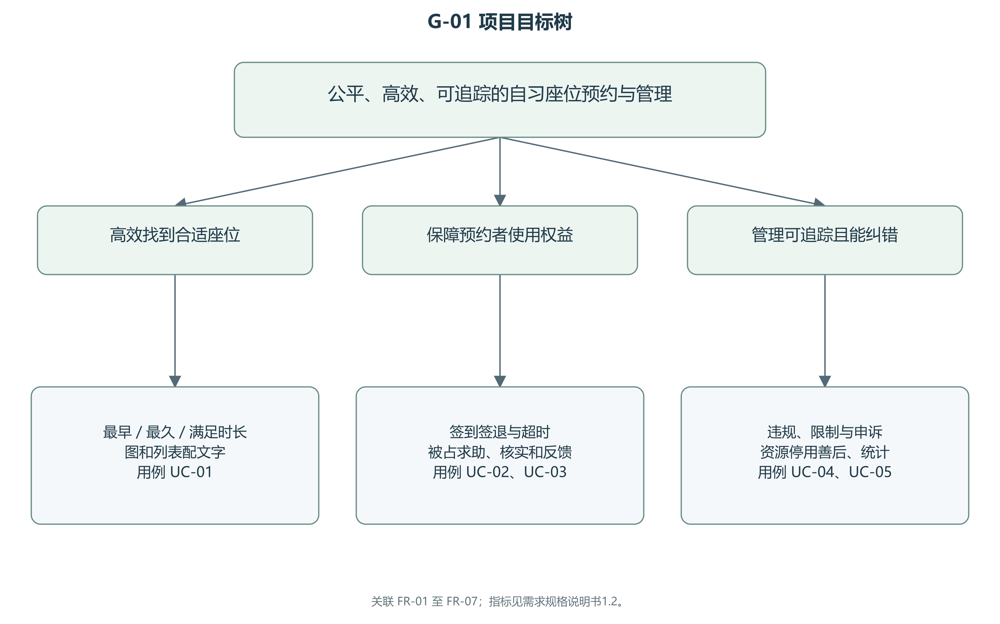

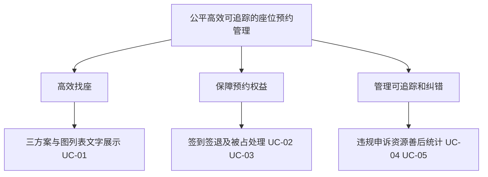

## CTX-01 系统上下文图

- 建模对象：智慧自习室系统边界、普通用户和学校统一管理员。
- 关联需求或用例：FR-01—FR-07；UC-01—UC-05；DEC-01／02／06／11。
边界依据 DEC-01、DEC-02、DEC-06、DEC-11。

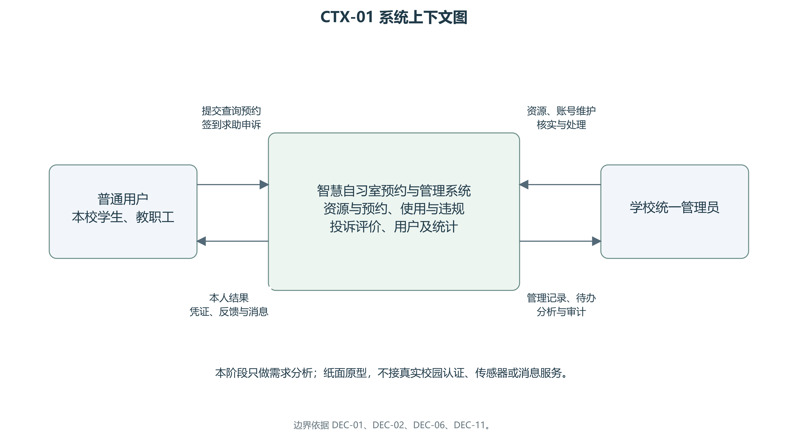

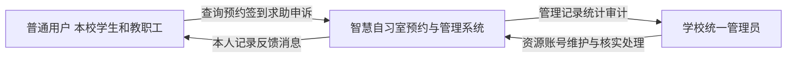

## UC-01 系统用例图

- 建模对象：两类参与者与主要使用、管理用例。
- 关联需求或用例：FR-01—FR-07；详细用例UC-01—UC-05。
采用UML参与者、系统边界、用例椭圆和关联线；详细用例编号沿正文。

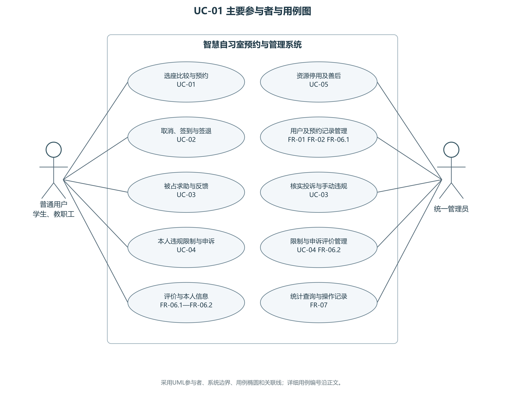

```plantuml
@startuml
left to right direction
actor "普通用户
学生、教职工" as U
actor "学校统一管理员" as A
rectangle "智慧自习室预约与管理系统" {
 usecase "选座比较与预约
UC-01" as B
 usecase "取消签到与签退
UC-02" as C
 usecase "被占求助与反馈
UC-03" as D
 usecase "本人违规限制与申诉
UC-04" as E
 usecase "评价与本人信息" as F
 usecase "资源停用及善后
UC-05" as G
 usecase "用户及预约记录管理" as H
 usecase "核实投诉与手动违规" as I
 usecase "限制申诉与评价管理" as J
 usecase "统计查询与操作记录" as K
}
U -- B
U -- C
U -- D
U -- E
U -- F
A -- G
A -- H
A -- I
A -- J
A -- K
@enduml
```

## DM-01 核心领域类图

- 建模对象：用户、预约、座位、空间、投诉、违规、限制、申诉及评价。
- 关联需求或用例：FR-01—FR-06；UC-01、UC-03—UC-05；规格3.2数据字典。
图示核心关联；使用、提醒、反馈、消息与日志详见数据字典。

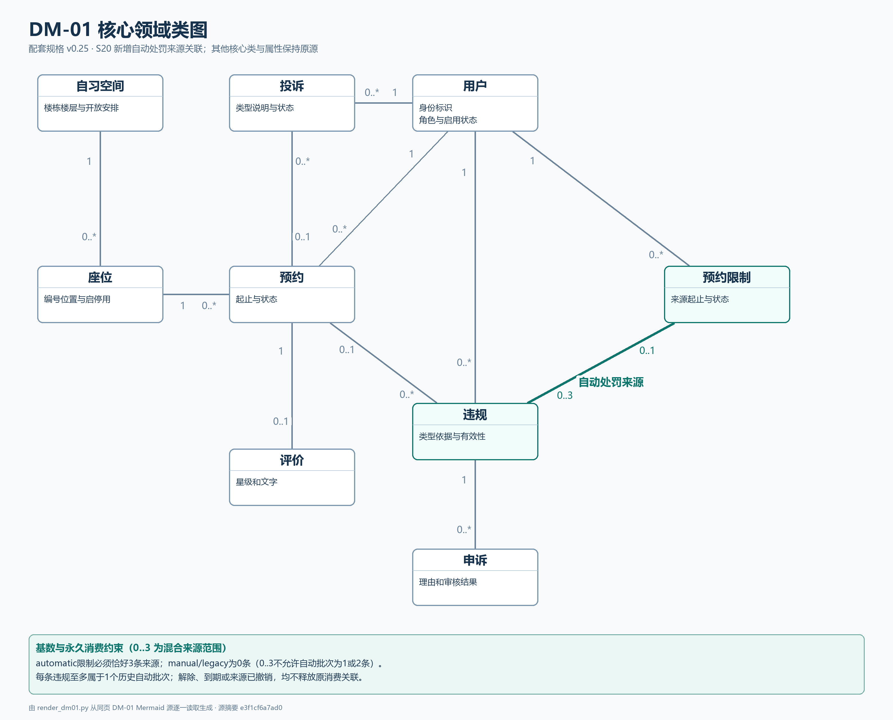

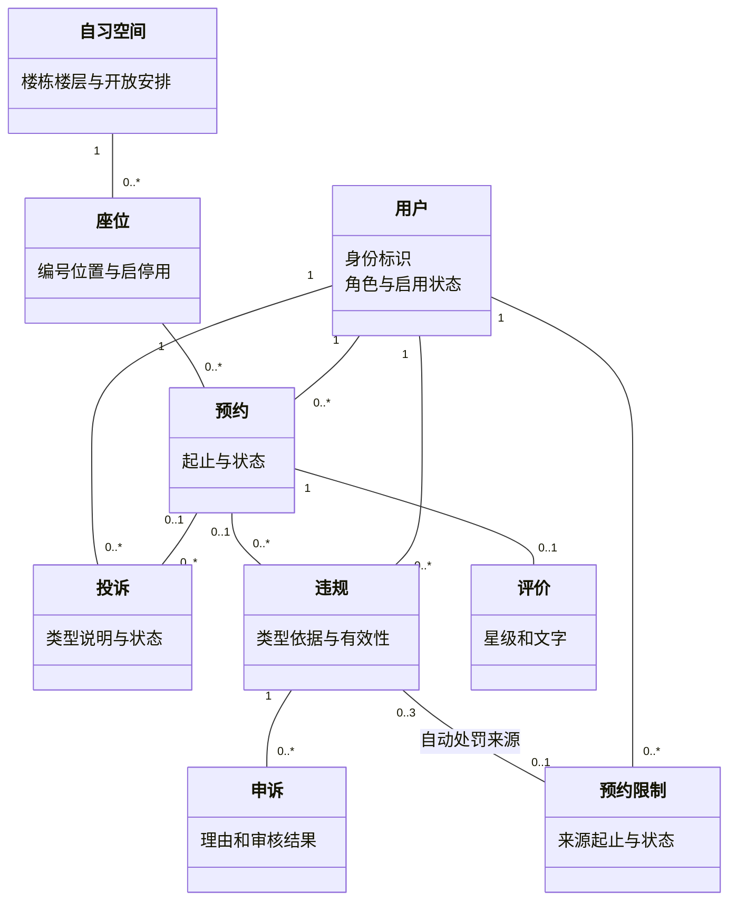

DM-01本轮S20开发修订：新增“自动处罚来源”关联，违规端0..3、预约限制端0..1；automatic必须恰好3、manual/legacy为0，每violation最多1个永久历史批次。

PNG由[本地可复现渲染脚本](render_dm01.py)逐一读取本节Mermaid中的所有class、属性、关联和DM01-NOTE脚注绘制，固定版式，非调用外部服务或imagegen。运行 `python docs/requirements/图模型/render_dm01.py`（需Pillow与本机微软雅黑或同等中文字体）。渲染程序遇不支持语法/缺布局节点会报错，不静默漏图；其余模型不变。原人工PV/校方复核未开展。

## SM-01 预约状态图

- 建模对象：单条座位预约。
- 关联需求或用例：FR-02、FR-03、FR-05；UC-01、UC-02、UC-04、UC-05；BR-02—BR-11、BR-16、BR-19、BR-21。
依据 BR-02—BR-11、BR-16、BR-19、BR-21；条件见质量报告A.4。

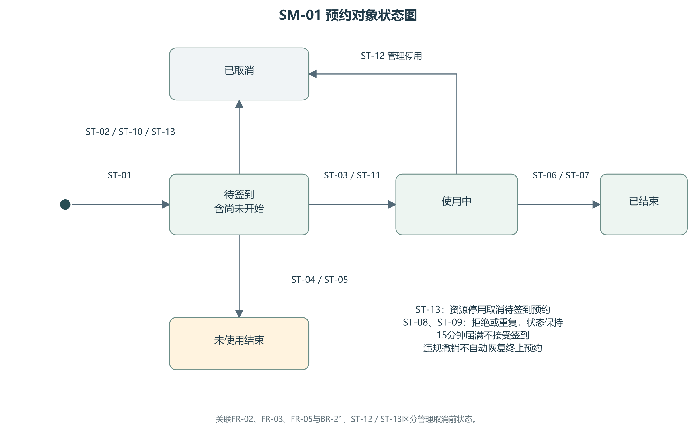

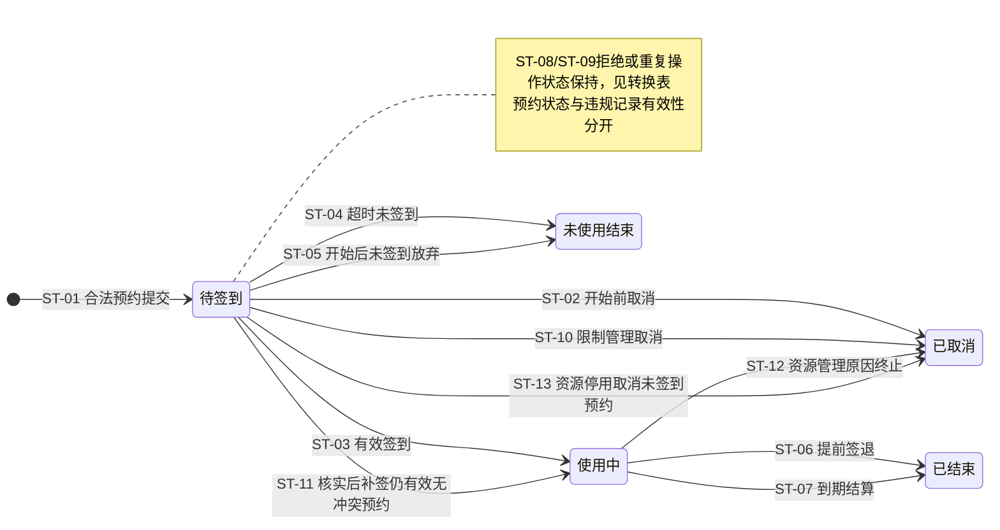

## SM-02 投诉状态图

- 建模对象：单条投诉。
- 关联需求或用例：FR-06.3；UC-03；BR-01、BR-12—BR-14。
依据 BR-12、BR-13、BR-14；ST-20—ST-26见转换表。

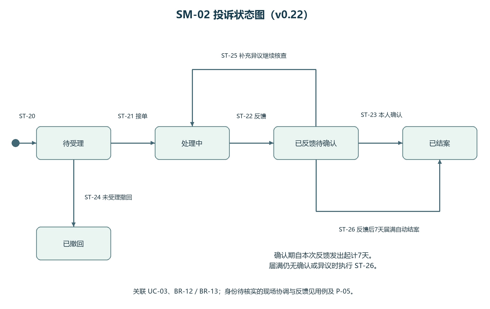

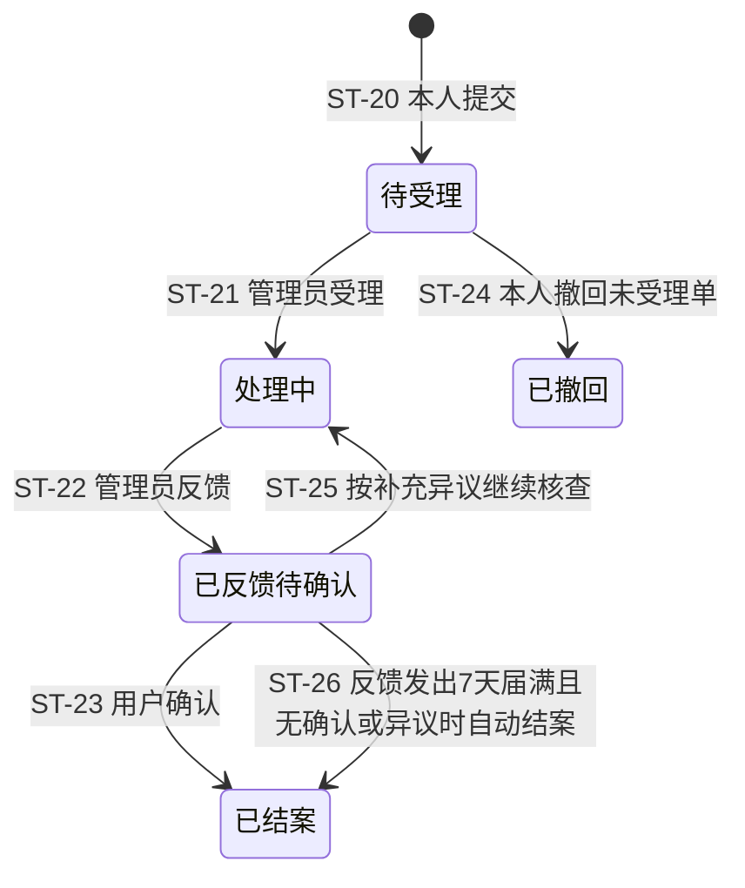

## SM-03 预约限制状态图

- 建模对象：单条预约限制记录。
- 关联需求或用例：FR-06.4；UC-04；BR-15—BR-18。
依据 BR-15—BR-18；本图建模单条限制，非整个用户账号。

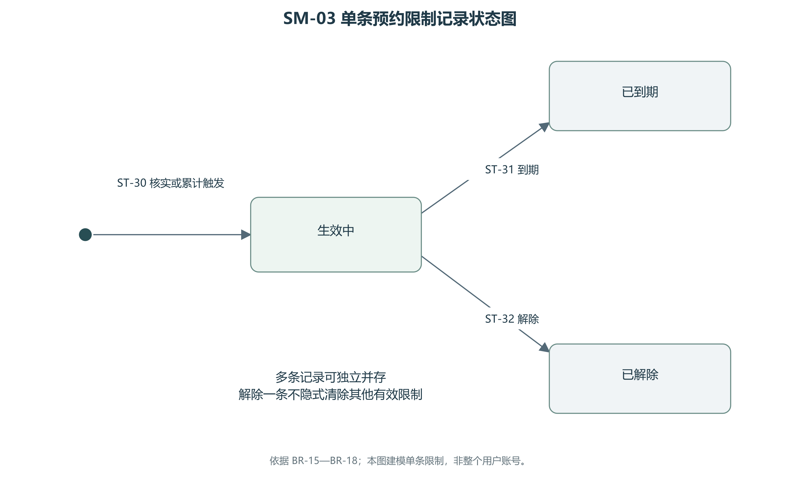

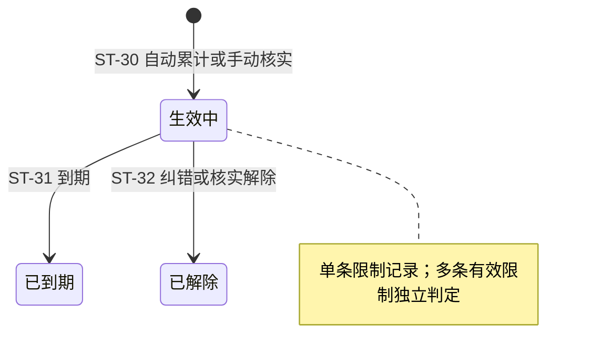

## SM-04 申诉提交状态图

- 建模对象：单条申诉；当前S21只提交，S22审核/撤销重算尚未实现、未验证。
- 关联需求或用例：FR-06.4；UC-04；BR-17；SC-05/PV-05；规格8.22；质量A4 ST-33。
- 状态转换：ST-33为无申诉至submitted；失败/超期/越权不新增申诉、既有状态保持，成功UUID重放不重复转换。
- 本地导出：[render_sm04.py](render_sm04.py)直接解析以下Mermaid源/注释，Pillow与现有微软雅黑生成；无网络或imagegen。root实际view_image视觉QA已通过（1800×1180/1状态1转换5注释清晰无截断遮挡），仅工程复核不冒人工PV。

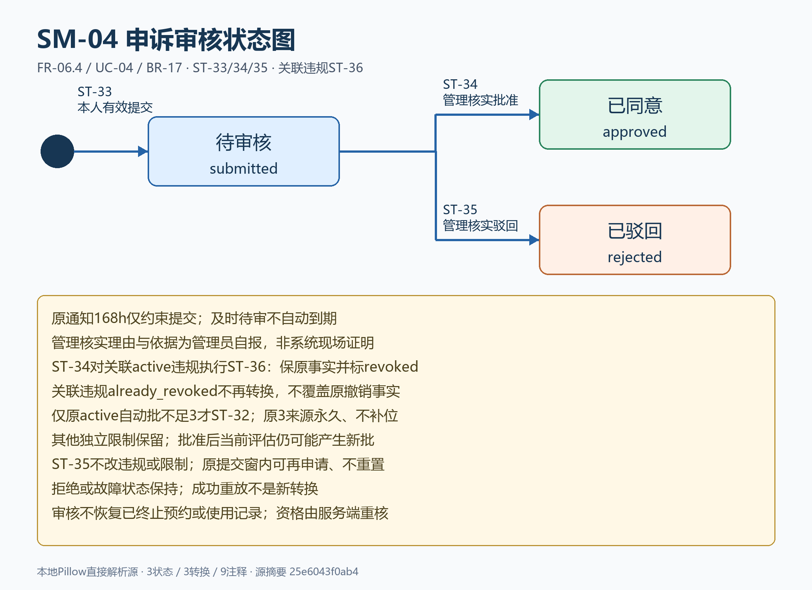

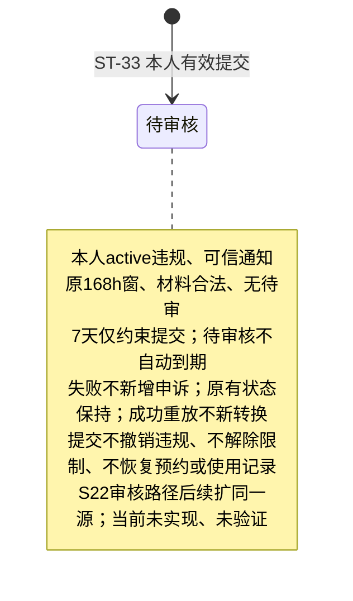

## AD-01 预约与使用活动图

- 建模对象：用户与系统的核心预约、签到及结束流程。
- 关联需求或用例：FR-02、FR-03；UC-01、UC-02。
双泳道区分角色；关键正常与超时分支，其他异常关联SM-01。

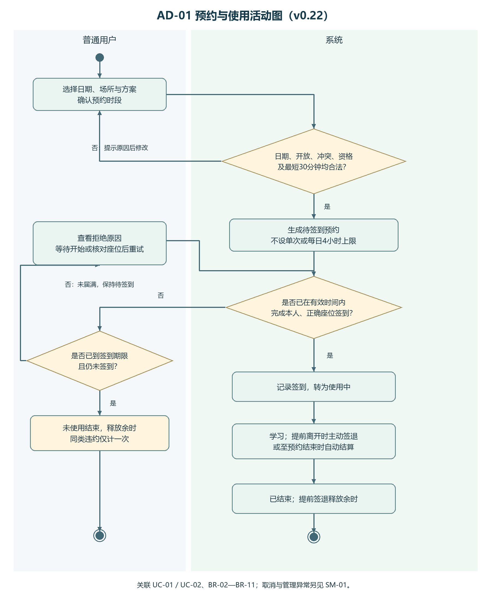

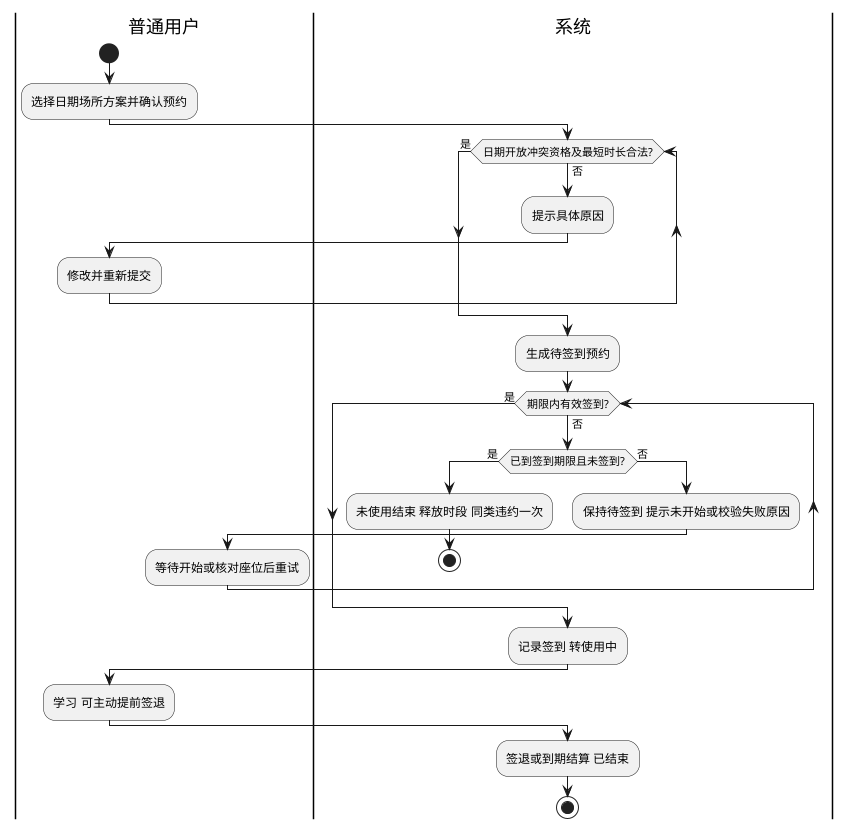

## STAT-01 统计页面模拟示意

- 建模对象：空间对比柱状图及近7日折线图的模拟数据。
- 关联需求或用例：FR-07、QN-02；SC-07；不是实测统计。
示例当日预约合计40，签到32人次；纸面不验证10秒刷新，不能作本校实测。

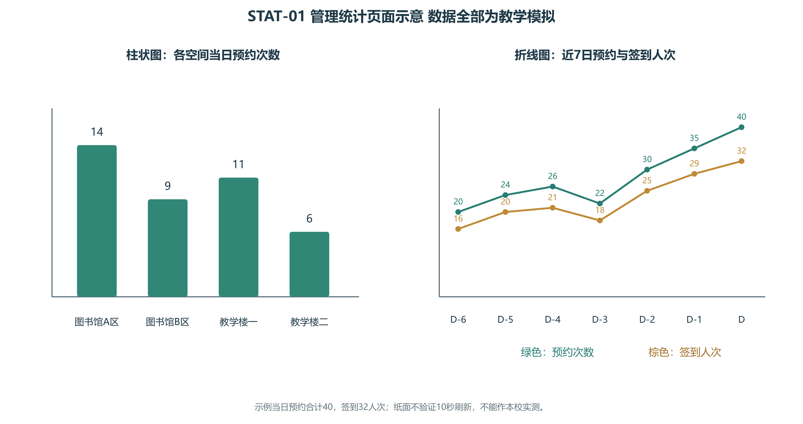

```text
模拟图表数据：
空间柱状图：图书馆A区14、B区9、教学楼一11、教学楼二6，合计40。
近7日预约次数：20、24、26、22、30、35、40。
近7日签到人次：16、20、21、18、25、29、32。
```


## v0.25 仓库导入与模型影响核对

2026-10-29将原v0.24可编辑代码与9张PNG原位导入仓库正式需求目录，原模型编号、关联需求和导出内容保持。当前开发范围见规格8.3；用户选择S07关闭旧候补/属性偏好新增入口、保留历史查询。上述旧实现不在本文件目标模型中，故此次范围收敛不另造核心对象或状态转换，不重绘无变化的模型。尚未实施S07，也未开展本轮人工模型复核；后续若开发发现真正影响模型的需求修订，必须同步可编辑源、导出、报告和验证记录。


### S03 用户字段映射（DM-01）

规格8.4把DM-01已有“用户—身份标识、角色与启用状态”及数据字典联系方式落实为campus_id、phone、email；既有student_no仅作迁移历史溯源，未知值不补造，不保留双写源。此为物理实现细化，没有新增领域类、关联或预约/违规状态转换，原Mermaid源与PNG保持同一抽象层次，故不重绘未变的图。管理理由与同事务审计沿用原数据字典“消息与日志”；S03实际结果见E-DEV-S03，记录时待验证，未开展人工模型复核。


### S05 资源字段与转换编号映射

[规格3.2/8.6](../01_需求规格说明书.md#s05-resource-fields)把DM-01已有自习空间/座位及位置启停概念细化为building、字符串floor、enabled、version、resource_reason和座位编号行列维护；旧未知位置不补造。capacity按实际available座位统计，seat_count含全部座位，bookable_capacity为空间启用时capacity、停用时0，均不替代查询时段空闲数。物理字段不新增领域类或关联，DM-01源/PNG语义不变。

已核对SM-01：ST-12=使用中预约因资源管理确认终止→已取消，ST-13=待签到预约因资源停用管理取消→已取消；二者均非资源启停状态编号。S05/S06在影响有效预约时拒绝并保持预约状态，不执行这两个转换，完整善后待S13。因此保留原源代码及导出中的转换语义，不将未实施的预约取消写成资源维护成功。S05结果复用E-DEV-S05，记录时待验证，原PV-06人工复验未开展。


### S06 开放安排与停用映射

[规格3.2/8.7](../01_需求规格说明书.md#s06-opening-schedules)将DM-01自习空间的“开放安排”及空间/座位启停原因作物理细化：ISO星期、整日日期例外及显式空窗口闭馆、开放窗口相邻规范化、跨日临时停用的独立多原因记录与并集计算。新安排为唯一运行权威，旧daily字段只读溯源；新模拟/管理空间每日08—22为可维护教学默认。普通窗口不扣预约，不是三方案空档。

这些细化不新增领域关联，也不改SM-01的预约转换条件或含义；安排/停用物理表不等于新增预约状态。ST-12/13仍是S13善后转换，本阶段影响有效预约就拒绝且状态保持，不执行管理取消，恢复开放不复活旧预约。故原可编辑图源与PNG语义保持不变，仅同步数据字典映射；S06工程和测试库真实页面验证已通过，范围见E-DEV-S06；人工模型复核及PV-06课程人工复验未开展。


S06开放窗口end=24:00仅表示当日右开结束边界，start不可24:00；同日预约和SM-01原转换语义不变，不新增跨日预约转换。S07负责统一预约存取及生命周期端点，当前模型映射说明不代表预约端已经支持。


### S07 分钟与结束端点映射（2026-10-30）

[规格8.8](../01_需求规格说明书.md#s07-booking-policy)落实原AD-01日期/最短时长/开放/冲突条件，保留DM-01预约起止与SM-01 ST-01创建及失败状态保持。Slot分钟/TIME24是物理表达，24只当日右开结束；历史raw秒/小数保留且可结束，不重写原值。原目标模型未纳入旧候补/偏好新增，按K-DEV-03退出旧实现不新增虚构领域对象或状态，历史来源保留。原可编辑源和PNG抽象语义保持一致。

S07工程与真实页面验收完成并提交00cf9ae，实际结果统一见F03 E-DEV-S07；S08已提交dc2bd13，S09已提交e1645d1，S10已提交183d5bf。原人工模型复核和课程PV不因AI执行改为通过。


### S08 未使用结束、独立违规与历史映射（2026-10-30）

[规格8.9](../01_需求规格说明书.md#s08-unused-violations)把原DM-01独立违规与预约关联、SM-01的未使用结束及ST-02/04/05落实为V7 violations、unused_ended、ended_at/reason/legacy_status和未使用事件唯一键。预约终态不等于违规有效性，未来撤销违规不复活预约。原图已表达这些业务语义，故物理细化不新增虚构类或转换，源/PNG抽象保持一致。

旧violation仅以legacy_status及legacy_violation理由保留原标记，未知ended留NULL，不从信用或模拟seed追造独立处罚；属于用户授权下的历史兼容技术取舍，无新人工核验。deadline到期结算是ST-04的真实系统转换，typed409须明确已结束，不能误记普通失败状态保持；普通拒绝未变更时仍保持状态。S08已本地提交dc2bd13；V7历史映射、取消/放弃/no_show及唯一独立事件、未知ended保真和同事务失败已验证，具体批次/实际页面见F03 E-DEV-S08；S09码、S10usage/暂离、S19/20限制未因本步完成，原人工PV与模型复核不追改。

### S09 座位标识与扫码转换实现映射（2026-10-30，工程/真实PNG上传闭环完成）

DM-01既有座位和预约本人关联、SM-01/AD-01的ST-03待签到→使用中保持；当前seat_codes仅细化座位可轮换标识的物理存储，不增加新的领域处罚/使用实体或状态。数据字典及规格8.10明确seat_id、code_value、enabled、独立version和时间，码本身不是物理到场证明，未扫码/无凭证旧入口拒绝。原图模型抽象语义未改，源与PNG均保留，不伪称重新导图或已人工复核。

新本人详情、携码请求及同事务签到复用统一本人/deadline/allowed_actions；已过deadline仍按S08 no_show，不能用扫码失败或抛异常倒退已提交事实。初次生成/轮换/启停为管理技术操作并审计，不改预约生命周期；码值不进入公开资源或审计。设计与验收见F03 S09，后端91全套后11相关/package、前端89全Node/build及audit0、真实PNG上传签到与管理码生命周期/390页均通过；当前92后端非全量重跑，打印/摄像头/手机及物理到场未验边界见E-DEV-S09，原PV-03仍为原实际范围；S10usage/暂离退出未因本步完成。

### S10 使用事实与结束状态实现映射（2026-10-30，工程/本轮真实页面完成）

DM-01原使用记录与预约一对一抽象、SM-01 ST-06提前签退/ST-07到期结算沿用，V9 usage_records把既有领域实体落实为唯一reservation_id写源，非新增或反转领域语义。物理字段及safe usage_record、origin/observed_at、历史诊断边界见规格8.11/F03；源和PNG抽象仍一致，无须为物理列重新造图，不冒称人工模型复核。

新扫码签到同事务建usage；提前/到期同一结束且释放余时，使用终止不等于违规，自动到期不新增处罚。旧rv时间只读原值、legacy不假称人工签退但可信early_checkout/auto_end/temp_leave_timeout理由不抹掉，无明确原因才legacy_unclassified；未知/矛盾（含既有ended与checkout不一致）拒迁不补造；旧temp_leave按cutover真值并保legacy原标记，不复活终态，不单列新暂离转换。原SC-03/PV-03实际范围不追改；本步后端111全套test/package与25迁移/Usage相关、前端98全Node/build及真实自动结束/PNG签到早退/余时新约/legacy与null/390页面通过，V-44/45根因修复复验；PG微秒保真、前端纳秒容错不等于DB纳秒持久化。AI/E-DEV-S10复用F03。

### S11 最早连续空档查询与图列表实现映射（2026-10-30，工程/本轮真实页面完成）

AD-01原日期/开放/本人和座位冲突/最早方案、DM-01座位预约与ST-01最终创建及失败状态保持语义沿用；S11把查询差集与图列表同源落实为无持久表的availability快照，非新领域实体或状态。多空档是每seat真实合法片段，不将存在空档解释为全天空闲；跨空间本人安排与历史精度处理见规格8.12/F04。

原可编辑源和PNG抽象语义保持一致，不为物理API/快照字段伪造重绘。单now/日期、同锁结算、最终POST复查、稳定排序和完整窗/本次起止的区分均为实现细化，不改变已确认BR或反转最短时长。前端106全Node/build、后端120全套后9相关/package及真实8片段/跨空间扣除/2D3D/抢占409恢复/390页面已过，工程与本轮页面已提交119bfe7；原人工/硬件校方未验边界见F04；S12最长/时长未实施，原PV-01人工范围及校方核验不追改。

### S12 同一空档的排序/筛选与建议区间映射（2026-10-30，工程/本轮真实页面完成）

原AD-01三方案及DM-01座位/预约关系不变，S12只在S11统一合法片段上追加longest排序/duration筛选和suggested区间，不增加领域表或状态；原可编辑源/PNG抽象保持一致，不伪称重导或人工模型复核。完整空档/建议/用户实际选择是三个显示层次，所需时长不成为新预约资格，ST-01最终创建仍沿BR-05等原规则。

规格8.13/F04记录严格参数、稳定排序、同shape图列表/2D3D、默认required和用户主动缩短提示；这是已授权技术表达，非新校方确认。后端127全套/16相关、前端115全Node/build和最终package及本轮A/B/C、主动30提示/真实提交、超全天真空与241分钟3D/390页面通过，S12已提交92ee230；设备/原人工校方及完整smoke等未验边界见F04，原SC-01/PV-01实际范围不追改。

### S13 管理取消与使用善后实现映射（2026-10-30，工程/本轮真实GUI完成）

原SM-01 ST-12使用中→已取消、ST-13待签到→已取消及UC-05/SC-06沿用，管理原因不等于用户违规，恢复不复活。确认即整条管理取消（包括未来临停影响当前后半段）、用态按确认时刻唯一Usage结算为分析细化，非新计划终止制度或人工校方确认；不把用态写completed冒充ST-12。

DM-01既有预约/使用/日志关系保持，V10 operation幂等和termination_note公开原因快照是实现支持，非第二使用事实源；协调source=admin_self_report及note仅管理私有，自报guard与真实物理核查分开。有效remaining两态统一max(start,now)且pending受15mdeadline，原保护/投影同纯函数，过去变化不机械取消；位置编号移动仍显式影响。源/PNG抽象语义保持一致，不伪重导或人工复核。

规格8.14/F05记录全入口/纯预览/同锁hash/事务幂等、立即终止与使用中自报guard；后端151全套/package、前端原131后11相关/build及最终skipTests包通过，V-48—52/Usage矛盾按范围复验；本轮room/Opening/本人原因usage、恢复不复活与中文消息分类/390GUI均过，已提交499c0f8；Usage共用纯检查不补事实，原SC-06/PV-06及校方核验不追改，fixture只模拟不冒充现场协调。

### S14 投诉提交与受控可选材料实现映射（2026-10-30，工程/本轮真实GUI完成）

DM-01既有投诉/预约/可选材料和SM-02 ST-20“无投诉→待受理”语义沿用；S14只落提交及submitted事件、本人详情/材料，不预造ST-21受理或反馈结案状态。V11 bytea暂存/绑定、context_snapshot和owner幂等是物理实现，非平行事实源；原可编辑源/PNG抽象保持，不虚构重导或人工复核。

本人历史预约可留被占证据但不认定仍有效/物理到场，不自动延长/恢复或撤销违规；核实/纠错后续实现。照片可选、私有鉴权及技术字节像素TTL边界见规格8.15/F06；本步后端175全套/package及前端148全套后15相关/build、V-53容器修复与兼容等工程已过，本轮真实提交/历史留证/无图和PNG绑定详情/下载鉴权/390核心GUI已过，最后表单/列表390与桌面1536/核心diff通过，工程/本轮GUI完成并已提交71cc31d，原SC-04/PV-04与校方确认不追改，S14交付时S15—17未提前实现，当前S15见下节。


### S15 受理、核实事件与独立提醒映射（2026-10-30，工程/本轮真实GUI完成）

SM-02沿ST-21待受理→处理中，核实五结果均保持处理中，不提前执行ST-22反馈或结案；DM-01图示核心投诉/预约关系不变，原注释明示提醒等细节见字典。S15原位物理实现首handler/version、immutable多actor核实、nullable subject独立提醒与操作幂等，仍是一份投诉过程记录，不是新处罚或第二预约/使用事实源。原可编辑源和PNG抽象语义一致，未重导、不伪造人工图审。

规格8.16/F06承接FR05/06.3、BR01/12/14：占座配合/拒绝必须关联res、管理员明确事实/历史权利依据且发生原时段；current_context纯读只显示当前，不反推过去身份权利。service_verified容纳无res一般服务核实、身份未知可留事件/提醒未知对象不猜，S18前零违规。公开本人事件/已知提醒安全DTO与管理私有证据分开，提醒不计违规；首受理人稳定且各追加actor保留是授权技术细化。当前实现及最终200全套/package、43相关、前端161/build通过，本轮testGUI双admin409/首handler保持、三类核实/提醒与service无res、本人公开进度/提醒安全/403及390通过，工程/本轮GUI完成已提交4ed2f0e，原SC04/PV04与校方/真人现场责任不改。


### S16 反馈响应与七天结案映射（2026-10-30，工程/桌面核心GUI通过）

SM-02既有ST22 processing→awaiting_confirmation、ST23本人确认→closed、ST24待受理撤回→withdrawn、ST25本人异议→processing、ST26反馈7×24h届满无响应→closed沿用；auto_closed仅事件类型/closure_type，不新增第六状态。现图无Feedback→Feedback自环，原文未明该覆盖路径，本版沿原processing反馈/异议后再反馈，不冒新的人工禁止；源和PNG既有抽象保持一致，不虚造重导/人工图审。

DM-01投诉/反馈/消息/日志原抽象保持，V13唯一反馈事件含result/basis/deadline，related_feedback_id明确响应及current_feedback投影，不造第二期限源；notifications nullablecomplaint_id仅真实关联，system actor null的LEFT JOIN保系统过程。current_feedback实际created+7×24、auto发生deadline/登记实际now区分，原事件/私有核实/提醒不变。GET到期落实本域closed但预约/Usage当前核对仍纯读，不推历史权利。规格8.17/F06记录精确端点、事务/幂等/并发/未知恢复与AC21，当前29迁移/69相关/V60后25与最终233/package、前端176后26相关/build过；桌面撤回确认/异议新反馈/旧页真实跨deadline与消息链接通过，V61文案修26相关/build过，本人515详情390通过/管理390未做，原14733 pending/usage null未改和other本人/admin详情403已查，工程/本轮GUI完成并已提交9357d5a，原SC04/PV04和校方/现场确认不追改。


### S17 服务目标与管理提示实现映射（2026-10-30，工程/本轮GUI完成）

本步服务目标不新增投诉生命周期状态或SM成功转换：accept完成occupation/首正式feedback完成service/withdraw停止仍沿原事件，原异议和新反馈不重开首次目标。service_target的running/overdue/late_completed等是管理目标投影，不是投诉状态或用户违规/行为提醒，不造新ST编号。

原UC03/BR13/QN07已含管理目标/超时提示，V14一投诉一冻结目标及一次检测事件为物理支持，非第二受理/反馈/完成事实源；完成/停止仍读原accepted/首feedback/withdrawn。旧occupation不反推、旧service派生和due发生/now检测来源清楚，未知目标完成不认定按时。DM核心图原抽象/注释由字典展开支持，源/PNG无需虚构重导或人工图审；规格8.18/F06补目标数据与本人/管理权限，原S16已提交9357d5a。当前后端270全套/package、40迁移/26专项及前端185全Node/build通过，本轮owner计时0自动GET/未知legacy/迟完成、管理动作与新反馈保持首目标/7天独立、focusedHTTP无违规提醒副作用/权限/原usage不改及owner/admin390通过，工程/本轮GUI完成已提交4233e6c；fixture模拟非实等目标时长，原SC/PV/校方现场不追改。


### S18 已核实拒绝的独立违规映射（2026-10-30，工程/本轮GUI完成）

DM-01既有用户—违规及预约0..1—违规核心关联保持；本步manual仍DB关联reporter原预约/immutable核实事件，public reservation_id=null只是第三人隐私投影，不把DB关系删掉。V15 sourceevent/registrant/operation与同事实tuple唯一、typed通知接收人FK为实现细化，通知详见字典，不造第二处罚事实源。抽象图源/PNG语义一致，无需虚构重导或人工图审。

违规active/revoked沿原独立记录，不把manual登记写成预约终态或投诉转换；SM-03 ST30是限制生效，S19—20后续，本步不执行或冒用。ordinary含停用/admin留事实不普通处罚、合法历史事件不限complaint阶段，属用户授权下分析采用；reason/本人通知安全投影与oldautomaticunknown见规格8.19/F07，原SC04/PV04与校园现场/人类确认不追改。当前最终312全套/package、54迁移/28manual相关与front196全套后26相关/build通过，V64/V66夹具复验/原失败保留，V65真实另JVM重放和本轮closed源登记/精确同fact409、本人安全通知/记录与owner/admin390通过；V67/68显示修后相关/build/skipTests新包和新例复验，不改旧事实/图语义，工程/GUI完成已提交d2379b9。旧auto通知unknown/disabled新通知仅SQL核验保持真实范围，不追认校方现场。


### S19 独立预约限制与余效映射（2026-10-30，工程/本轮GUI完成，已提交ad69e07）

SM-03 ST30生效、ST31到期、ST32核实解除本步落实manual/legacy范围，原多独立限制语义不变，S20automatic累计后续。活动[start,end)由server判、expiredrelease不当人工ST32，成功replay不重复转换，解除不复活预约；生效其他仍有效pending管理取消/checkedin不终止，已到no_show先原统一结算，不改原预约转换或捏Usage。

DM-01原用户—预约限制与独立来源抽象保持，V16/Policy/Workflow物理支持唯一restrictions权威；Policy资格/投影纯读、同模块事实/通知/审计写MANDATORY受调用方事务约束且无Booking反依赖，不另把credit字段平行作资格。legacy starts=cutover为真实余期接管起点，原处罚起点/原因未知，源/字典说明不把虚构历史画成图；真实effect执行晚于迁移则如实记。源/PNG既有抽象一致无需虚重导/人类图审。

规格8.20/F07维护精确API/失败typed403/首effects幂等、private核实与公开记录、通知真本人关联和新manual/legacy运行差异。legacy未applied先release只处理既成到期/其它active、不追本条futurepending，effects可能非0；全userfuturelegacy含admin保真与系统guard不误套。当前V16正常首次应用/68迁移、47相关与352全套/package及前端208全套后57/11相关/build通过，本轮manual重叠/单release、legacy真实执行、2D3D403/owner-admin390和全解除后新约/旧取消不复活通过，最终只读核17122新约/旧取消保留、原使用中/旧credit截止流水及真实activeflag、通知审计各单次通过；工程/本轮GUI完成已提交ad69e07；V73无改前实测500、V74仅测试完整JSON数值类型等值修，原SC05/PV05和校方现场未开展不追改，用户自主分析采用不代校方确认。


### S20 自动批评估与永久消费映射（2026-10-30，工程与本轮GUI完成/已提交f9ad4e2）

原DM-01/数据字典的预约限制“支持违规”关系本步由V17本批评估+恰好3永久来源具体落地，不新建第二违规/限制核心。source永久唯一、原选取序/原评估闭窗与starts/168h，当前sourceactive/revoked显示不抹原active快照；manual/legacy无评估对象或消费来源，不从reason猜。root实读原DM-01确认缺违规—限制核心来源线，已补违规端0..3/限制端0..1、label自动处罚来源与恰3/其余0/永久关联脚注；本页Mermaid与PNG同步，render_dm01.py直接解析9类/11关联/属性/脚注生成3120×2520，源摘要e3f1cf6a7ad0，root实际view_image确认可读无挡/重数一致，工程复核通过非原人工PV。仅DM本轮更新，其他图沿用不虚称重绘。

原SM-03 ST30自动或手动生效与ST31/32独立条目沿用；一次评估一批/active不叠建，但lastrelease恢复后同微秒可新评估另3，不加时间戳unique。Book完整批先no_show/Usage再评估/enforce，取消不罚/使用继续，不造新预约状态。S22仅原批原评估不补位是本轮授权分析采用，未预实现撤销/申诉。

规格8.21/F07维护exact历史automatic_evaluation/3safe来源、system显示及全入口同核。后端最终393全套0失败/错误/跳过及package07:56:50通过（work/s20-backend-full-initial.log）；82迁移/97相关批次已过但重叠不相加。前端仅本步67相关（4新意义用例）及productionbuild通过（work/s20-frontend-tests.log/build.log），S19full208为旧基线，不冒本步212全测。V17首次正常应用无checksum修/回退，应用前静态补search_path不造原运行失败。 root在8081 health精确核studyroom_java_test后完成本轮真实GUI/聚焦HTTP/只读SQL：第三manual触发auto256、startup首批255及release后余留新批257，3来源原序/原评估闭窗与当前资格准确；原使用中保结束/有效pending管理取消无新罚，原reporter预约Usage/投诉不改且本人违规0。本人安全DTO/3D真实403三来源展开及owner/admin/3D390均通过，无第三方身份泄漏或页面横溢。聚焦HTTP7checks与只读9来源/9distinct、每批恰3及通知审计单次通过，非完整HTTP smoke。 详细结果唯一F07 E-DEV-S20，源/PNG/脚本及root实际视检只属工程QA。工程及本轮真实GUI完成，root已自查暂存并本地中文提交f9ad4e2，不push；原SC05/PV05、校方现场/独立审核/真实断网和硬件能力未验不追改，B5未另布置，S20交付时S21仅只读准备，当前S21合同见后续F08/规格8.22。

### S21 申诉提交与材料用途映射（2026-10-30，工程/含V83本轮GUI完成/待本地commit）

FR06.4/BR17/UC04/AC15—16/SC05/PV05、规格8.22/F08：DM-01原违规“1”→申诉“0..*”保持，支持保留多次历史且同刻只一submitted。按报告约束A4，本步新增SM-04与ST-33无申诉→submitted，源/PNG/render_sm04.py同步；图只当前S21，审核S22后续扩同源，不预建代码。权限/超期/故障不新增/原状态保持，成功replay无新转换，待审不因原7天提交窗届满自动到期；不冒用限制ST32。图为1800×1180/1状态1转换5注释/源摘要b4b67bc598d6，本地脚本直接解析Mermaid，文档agent已view可读无挡，root实际view_image确认1状态/1转换/5注释清晰、无截断遮挡，工程视觉QA通过，不冒原人工PV。

V83前完整433/0失败/0错误/0跳过test-only于08:40:14通过；98迁移/47业务/12二维码相关独立重叠不相加。前端V79后56相关/build、V82后37相关/build及13:53:14包是此前批次，未冒前端全量。V83后端23/0失败/0错误/0跳过（原22+新增1）14:01:49通过（work/s21-backend-v83-appeal-tests.log），前端17/17及build通过（work/s21-frontend-v83-regression-tests.log、v83-build.log），最新dist另skipTests package14:03:55通过（work/s21-backend-v83-package.log）；V83前08:40:14完整433与后23重叠不相加，未全434重跑。 本轮真实testGUI通过图片申诉61/纯文字62、过期409保草稿且无新申诉、pending既有入口、unknown无猜截止、manual第三方来源隐私、本人进度/原限制保持、管理只读待办/原件图片与desktop/390；48项聚焦只读HTTP/图片SHA/ACL及独立只读原领域不变核对通过，非完整HTTP smoke。 本轮成功提交61/62为ST33，过期/unknown/重复待审不新转换；原限制374及原领域不改。源/PNG/script及rootQA只属工程证据，不替人PV，V82自动复验边界/失败日志缺口按F08维护。S21工程及本轮全部实际GUI（含V83管理源核查）完成，待root最终diff/暂存自查与本地中文commit，未预填hash、不push；S22/S23未实施，未预填hash、不push；S22审核重算与S23补签未实施。 原人PV05/校方现场/独立审核/真实断网/硬件相机与物理到场未验保持，B5未另布置；工程模拟材料/work Clock不冒真实校园，V82只自动/SSR复验未重造临截止GUI。

V83只补admin detail management_context的真实源关联/现时事实，不改DM关联或ST33，不将safe提交快照冒原源事实，不新增owner第三方权限；23后端/17前端与build/最新包、fresh申诉84本人和admin真源/390复验通过。
