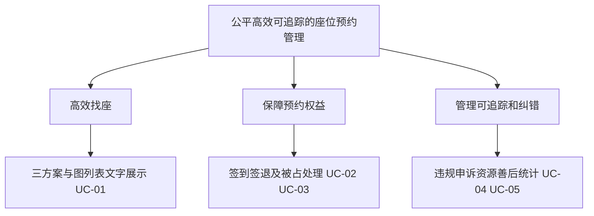
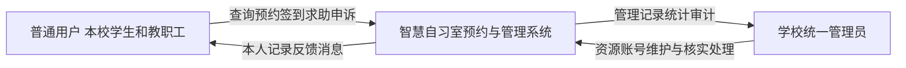
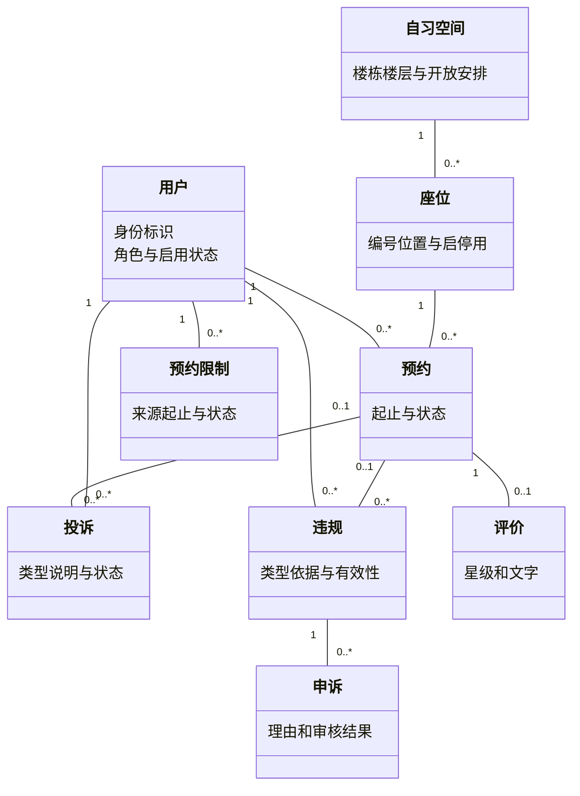
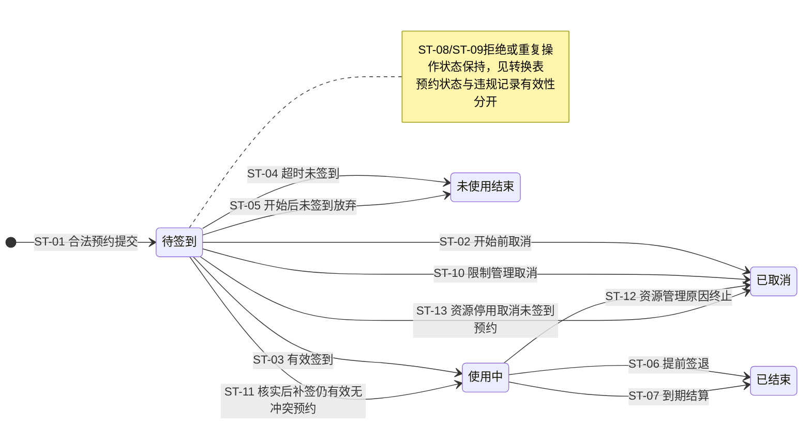
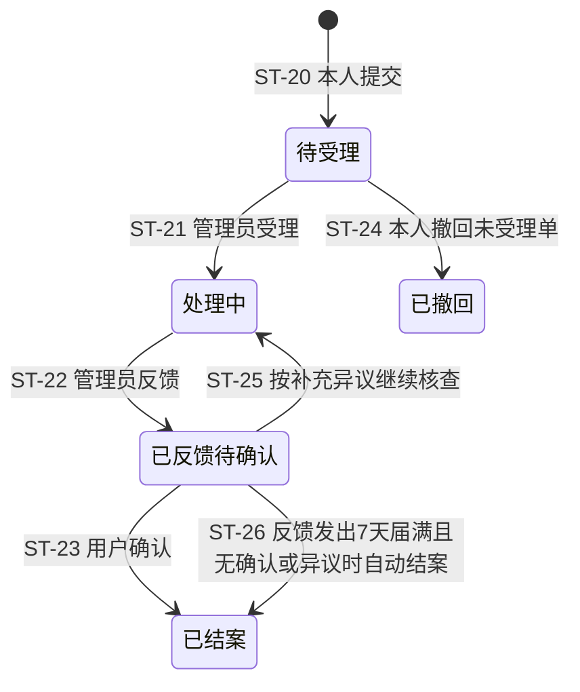
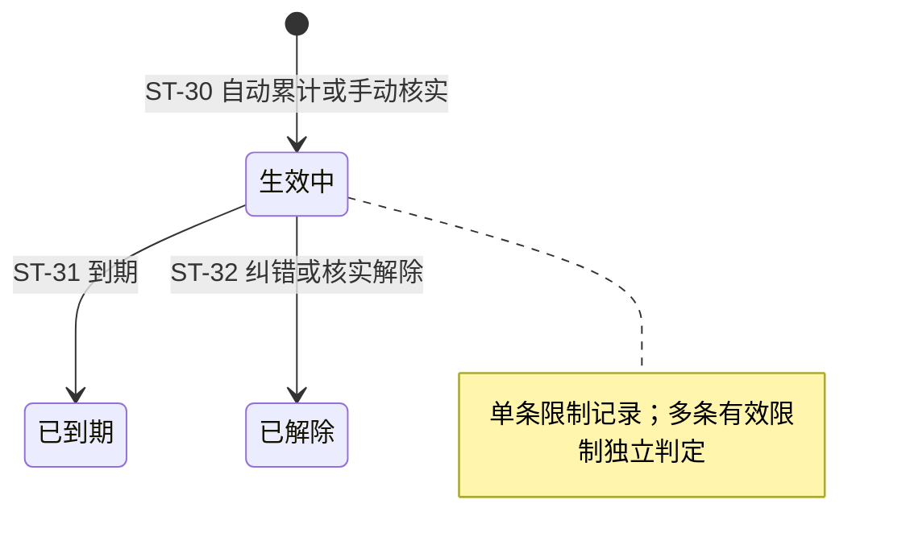
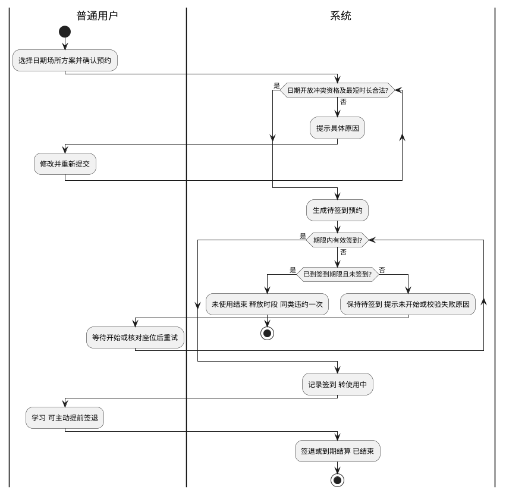

# 图模型与可编辑源说明

第11组，配套报告v0.24。模型源为下列Mermaid／PlantUML代码，PNG为配套导出；业务内容与图件沿用v0.22。模型关联当前规格及纸面原型P0.4，投诉反馈确认期为7天。

## G-01 项目目标树

- 建模对象：本系统业务目标及子目标。
- 关联需求或用例：FR-01—FR-07；UC-01—UC-05，成功指标见规格1.2。




## CTX-01 系统上下文图

- 建模对象：智慧自习室系统边界、普通用户和学校统一管理员。
- 关联需求或用例：FR-01—FR-07；UC-01—UC-05；DEC-01／02／06／11。
边界依据 DEC-01、DEC-02、DEC-06、DEC-11。




## UC-01 系统用例图

- 建模对象：两类参与者与主要使用、管理用例。
- 关联需求或用例：FR-01—FR-07；详细用例UC-01—UC-05。
采用UML参与者、系统边界、用例椭圆和关联线；详细用例编号沿正文。


```plantuml
@startuml
left to right direction
actor "普通用户
学生、教职工" as U
actor "学校统一管理员" as A
rectangle "智慧自习室预约与管理系统" {
 usecase "选座比较与预约
UC-01" as B
 usecase "取消签到与签退
UC-02" as C
 usecase "被占求助与反馈
UC-03" as D
 usecase "本人违规限制与申诉
UC-04" as E
 usecase "评价与本人信息" as F
 usecase "资源停用及善后
UC-05" as G
 usecase "用户及预约记录管理" as H
 usecase "核实投诉与手动违规" as I
 usecase "限制申诉与评价管理" as J
 usecase "统计查询与操作记录" as K
}
U -- B
U -- C
U -- D
U -- E
U -- F
A -- G
A -- H
A -- I
A -- J
A -- K
@enduml
```

## DM-01 核心领域类图

- 建模对象：用户、预约、座位、空间、投诉、违规、限制、申诉及评价。
- 关联需求或用例：FR-01—FR-06；UC-01、UC-03—UC-05；规格3.2数据字典。
图示核心关联；使用、提醒、反馈、消息与日志详见数据字典。




## SM-01 预约状态图

- 建模对象：单条座位预约。
- 关联需求或用例：FR-02、FR-03、FR-05；UC-01、UC-02、UC-04、UC-05；BR-02—BR-11、BR-16、BR-19、BR-21。
依据 BR-02—BR-11、BR-16、BR-19、BR-21；条件见质量报告A.4。




## SM-02 投诉状态图

- 建模对象：单条投诉。
- 关联需求或用例：FR-06.3；UC-03；BR-01、BR-12—BR-14。
依据 BR-12、BR-13、BR-14；ST-20—ST-26见转换表。




## SM-03 预约限制状态图

- 建模对象：单条预约限制记录。
- 关联需求或用例：FR-06.4；UC-04；BR-15—BR-18。
依据 BR-15—BR-18；本图建模单条限制，非整个用户账号。




## AD-01 预约与使用活动图

- 建模对象：用户与系统的核心预约、签到及结束流程。
- 关联需求或用例：FR-02、FR-03；UC-01、UC-02。
双泳道区分角色；关键正常与超时分支，其他异常关联SM-01。




## STAT-01 统计页面模拟示意

- 建模对象：空间对比柱状图及近7日折线图的模拟数据。
- 关联需求或用例：FR-07、QN-02；SC-07；不是实测统计。
示例当日预约合计40，签到32人次；纸面不验证10秒刷新，不能作本校实测。


```text
模拟图表数据：
空间柱状图：图书馆A区14、B区9、教学楼一11、教学楼二6，合计40。
近7日预约次数：20、24、26、22、30、35、40。
近7日签到人次：16、20、21、18、25、29、32。
```


## v0.25 仓库导入与模型影响核对

2026-10-29将原v0.24可编辑代码与9张PNG原位导入仓库正式需求目录，原模型编号、关联需求和导出内容保持。当前开发范围见规格8.3；用户选择S07关闭旧候补/属性偏好新增入口、保留历史查询。上述旧实现不在本文件目标模型中，故此次范围收敛不另造核心对象或状态转换，不重绘无变化的模型。尚未实施S07，也未开展本轮人工模型复核；后续若开发发现真正影响模型的需求修订，必须同步可编辑源、导出、报告和验证记录。


### S03 用户字段映射（DM-01）

规格8.4把DM-01已有“用户—身份标识、角色与启用状态”及数据字典联系方式落实为campus_id、phone、email；既有student_no仅作迁移历史溯源，未知值不补造，不保留双写源。此为物理实现细化，没有新增领域类、关联或预约/违规状态转换，原Mermaid源与PNG保持同一抽象层次，故不重绘未变的图。管理理由与同事务审计沿用原数据字典“消息与日志”；S03实际结果见E-DEV-S03，记录时待验证，未开展人工模型复核。
