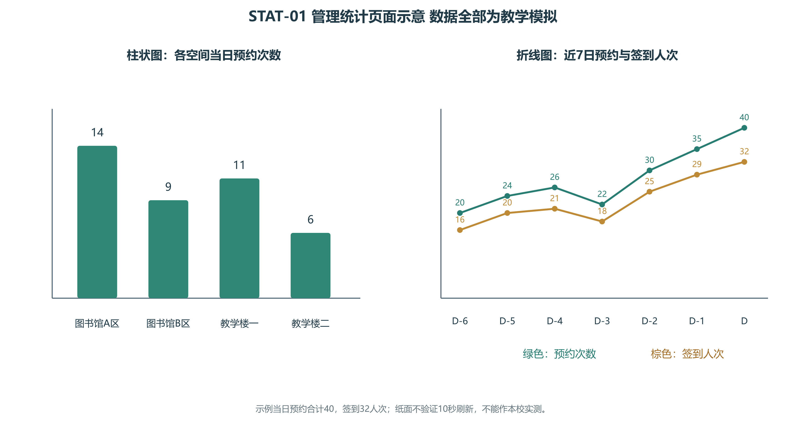

# 智慧自习室纸面原型与查看说明

版本P0.4；修订日期2026-10-29，需求分析阶段；第11组。查看者为实际参加走查的学生，日期按实际查看时填写。

这是Markdown纸面页面草图，用于检查信息、流程和提示。页面中的链接表示查看顺序，不执行预约、计时、违规、真实扫码或权限校验。所有座位、时段、记录与图表数据均为教学模拟。

## 页面目录

| 页面 | 内容 | 关联场景 |
|---|---|---|
| P-01 | 选座与三种方案、图和列表切换 | SC-01 |
| P-02 | 预约确认与冲突提示 | SC-01、SC-02 |
| P-03 | 我的预约、签到和签退 | SC-03 |
| P-04 | 座位被占求助与进度 | SC-04 |
| P-05 | 管理员核实处理 | SC-04 |
| P-06 | 违规、预约限制与申诉 | SC-05 |
| P-07 | 资源停用影响确认 | SC-06 |
| P-08 | 管理统计、评价与个人信息 | SC-07 |

## P-01 选座

页面标题：找一个适合现在学习的座位。

| 查询条件 | 示例输入 |
|---|---|
| 场所 | 图书馆A区（模拟） |
| 日期 | 教学示例日D，可选择D、D+1、D+2 |
| 当前时间 | 15:00 |
| 选座方案 | **最早可约**／连续可用最久／满足我的学习时长 |
| 所需时长 | 选择第三种方案时输入，例如120分钟 |
| 展示 | **座位平面图**／座位列表 |

平面示意使用较大座位块，编号与文字同时显示。密集空间分区、分页或放大查看，不将全部座位缩成难以辨认的圆点。

| 靠入口的一排 | 中间区域 | 靠后区域 |
|---|---|---|
| A座：稍后可约；15:10—16:10 | B座：稍后可约；15:30—19:30 | C座：稍后可约；15:20—17:20 |

列表视图示例：当前选择“最早可约”，按开始时间升序显示同一组座位。

| 座位 | 可约起止 | 连续时长 | 等待 | 操作 |
|---|---|---|---|---|
| A | 15:10—16:10 | 1小时 | 10分钟 | 查看并预约 |
| C | 15:20—17:20 | 2小时 | 20分钟 | 查看并预约 |
| B | 15:30—19:30 | 4小时 | 30分钟 | 查看并预约 |

切换方案后的列表展示如下。表中时长为下一段合法空档，确认时可在其中选择满足规则的起止时间；第三种方案按本次需求取120分钟。

| 方案及输入 | 依次显示的结果 | 结果信息 |
|---|---|---|
| 最早可约 | A、C、B | 分别显示上述空档、时长与等待时间 |
| 连续可用最久 | B、C、A | 分别显示4小时、2小时、1小时及对应起止 |
| 满足我的学习时长：120分钟 | C、B；A不满足时长 | C可选15:20—17:20，B可选15:30—17:30；仍可查看完整空档 |

纸面展示不自动重排。未来系统的结果受最短30分钟、本人其他预约、开放与停用时段约束；不设单次或每日累计4小时上限。

选择座位后查看P-02对应的A或C示例。两种视图切换应保留查询条件，具体交互仍需成员审阅。

## P-02 确认预约

### 示例A：预约A座1小时

| 信息 | 示例 |
|---|---|
| 场所与座位 | 图书馆A区（模拟），A座 |
| 日期与时间 | D日15:10—16:10 |
| 本次时长 | 60分钟 |
| 规则摘要 | 单次至少30分钟，无单次或每日累计4小时上限；仍需处于开放且无冲突的连续时段；开始后15分钟届满仍未签到将结束预约并记一次违约 |
| 操作 | 确认预约／返回修改 |

### 示例C：SC-01中预约C座2小时

| 信息 | 示例 |
|---|---|
| 场所与座位 | 图书馆A区（模拟），C座 |
| 日期与时间 | D日15:20—17:20 |
| 本次时长 | 120分钟 |
| 签到期限 | 15:20起可签到，须早于15:35完成 |
| 操作 | 确认预约／返回修改 |

成功提示示意：预约已创建，查看我的预约。P-03以A座示例解释签到边界；若沿用C座，显示15:20—17:20及15:35签到截止，不能照搬A座时间。

失败提示示意（纸面展示，未执行后台）：

| 失败原因 | 页面提示与后续操作 |
|---|---|
| 座位时段被占 | 该时段已被预约，请返回选择其他座位或时间 |
| 本人时间重叠 | 与您已有预约时间重叠，请查看已有预约或修改起止时间 |
| 少于30分钟或超出开放时间 | 请预约至少30分钟，并在开放时间内选择连续可用时段 |
| 预约资格受限 | 显示限制原因、截止时间及详情入口；不得创建预约 |
| 他人私密记录 | 无权查看该记录，请返回本人列表；不展示他人数据 |

当天已预约4小时或本次预约超过4小时，不单独构成失败原因。

## P-03 我的预约

示例当前时刻15:15，预约A座15:10—16:10，尚未签到。

| 状态 | 信息与操作 |
|---|---|
| 待签到 | 预约凭证：场所、座位、日期、起止时间；最晚须在15:25之前完成签到 |
| 可用操作 | 扫描对应座位二维码签到／座位被占求助／放弃本次预约 |
| 放弃提示 | 当前已经开始，放弃将释放时段并记一次违约；开始前取消不计违规 |

签到后展示：状态“使用中”，显示签到时间、原结束时间，并提供显著按钮【提前离开并签退】。确认文案：“确认结束本次使用并立即释放剩余时段？”确认后记录签退。提前离开时应主动签退，不等待原结束时间才释放。到期自动变已结束，不额外处罚漏点签退。

15:25整仍未签到的分支：状态未使用结束，显示违约原因及申诉入口。重复自动检查不应再计一次。纸面原型不运行时钟。

短暂离开时原预约仍有效但不延长；本期不提供单独续约或暂离计时。若现场被占转P-04。

## P-04 求助与进度

### 用户可见入口

主导航：【找座位】｜【我的预约】｜【服务与反馈】

“服务与反馈”页面明确显示：【座位被占求助】｜【一般服务投诉（无需预约）】。
“一般服务投诉”可填写照明、设施等问题，选择相关空间并描述情况，不强制关联预约。占座求助仍可从“我的预约”进入。

| 表单字段 | 示例或要求 |
|---|---|
| 问题类型 | 座位被占／服务问题／签到异常 |
| 关联预约和座位 | 占座求助从本人预约带入；一般服务投诉可不关联预约，选择相关空间或说明问题 |
| 情况说明 | 描述到场时间、发现情况和沟通结果 |
| 照片 | 可选，不要求拍摄他人身份信息 |
| 操作 | 提交求助／返回预约 |

提交提示：“已收到。开放时段内目标在15分钟内接单并开始核查；这不是15分钟到场或解决承诺。处理人、最新进展会在本页显示。”非开放时段从下次开放时刻计算；普通服务投诉24小时内首次反馈。提交本身不延长签到期限。若因被占或平台故障错过签到，可申请核实纠错。

进度示意：待受理→处理中→已反馈待确认→已结案。反馈显示处理结论、说明、反馈时间及确认截止时间；用户可确认结果或补充异议。未受理时可撤回。团队接受留出确认时间后自动结案；确认期为本次反馈发出后7天；期间有异议转回处理中，重新反馈后从该次反馈时刻起计7天。

管理员受理和处理查看P-05。

## P-05 管理员核实

管理员看到：相关预约、座位、投诉说明、提交时间、处理目标及当前状态。

| 步骤 | 页面所需信息或操作 |
|---|---|
| 接单 | 受理并记录处理人，开放时段15分钟内接单并开始核查目标，不承诺15分钟内到场或解决，超时提示 |
| 核对 | 预约是否有效、是否同一座位或时段、现场情况；须核实占用者身份后才能归属违规 |
| 配合纠正 | 提醒并记录处理经过，不增加违规次数 |
| 拒不配合 | 记录核实事实、当事人和依据，登记一次违规 |
| 拒不配合且拒绝提供身份 | 记录“身份待核实”、现场事实及协调进展，继续处理；需转交时按校内权限交由现场负责人，承接岗位和联系方式待业务方确认；不猜测用户归属，不声称已完成处罚 |
| 未查实或存在误解 | 记录情况并解释，不仅凭投诉计违规 |
| 反馈 | 填写处理结果后反馈给投诉人 |

系统无法替管理员到场或强制让座，现场动作属于拟定管理流程。未知占用者身份时可保留事件，不将违规随意归给他人。

## P-06 违规与申诉

全部使用模拟用户甲，不对应本组任何成员。

| 模拟记录 | 状态 |
|---|---|
| 当前周期内第1次未签到 | 有效 |
| 当前周期内第2次未签到 | 有效 |
| 当前周期内第3次拒不配合纠正占座 | 有效 |

限制提示：30天内累计3次有效违规，暂停预约7天，显示开始、截止时间和原因。已有未签到预约管理取消并通知，不记新的违约；已签到预约保留至原结束。

违规详情提供7天内申诉入口。管理员审核成立时撤销误记违规、重算限制；本场景无其他限制，重算后解除。原始记录和纠错依据保留，已经取消的预约不自动恢复。

预约入口示意：【预约受限 · 暂不可预约】（禁用，深灰外观并配文字，不仅靠颜色表达）。附近始终显示原因和截止时间；【查看限制详情／申诉】保持可用。存在另一条有效限制时，解除本条后预约入口仍保持受限，只有全部限制失效才恢复预约。

限制期间新发生的违规按原发生时间纳入恢复后的新周期；已用于处罚的旧违规不重复触发。

界面必须区分提醒、有效违规、已撤销违规和仍生效的限制，不能将它们合成一个不明含义的分数。

## P-07 资源停用

管理员拟停用A座，先看到影响清单：未来未签到预约1条、正在使用预约1条。

| 操作 | 预期页面与业务说明 |
|---|---|
| 查看影响 | 列出受影响预约和使用情况 |
| 填写原因 | 例如模拟设施维护；显示计划停用起止时间 |
| 影响清单明细 | 分别展示预约编号、座位、日期起止、待签到／使用中状态、拟处理方式与通知状态，个人身份仅管理员按职责查看 |
| 取消本次停用操作（尚未确认） | 关闭确认框，不修改资源、不取消预约、不发停用通知；不同于停用后恢复开放 |
| 确认停用 | 管理取消受影响预约，通知用户，不登记用户违约，保留历史 |
| 使用中处置 | 通知并由管理员协调，记录管理原因终止 |
| 以后恢复 | 座位重新进入可约范围，原取消预约不自动恢复 |

纸面不执行通知或取消，需要成员检查说明是否完整。

## P-08 统计评价与个人信息

管理员统计页含预约次数、签到人次、签到记录推算使用时长、有效违规次数和投诉待办。柱状图按自习空间比较；折线图展示近7日趋势。标题和图注必须注明本页为模拟数据，不能写成本校实测结果。

| 刷新展示 | 示意 |
|---|---|
| 正常 | 最近更新：示例时刻；每10秒自动刷新（未来系统要求） |
| 失败 | 本次刷新失败，保留上次数据与时间，提供重试；已知原因时展示“网络连接异常”或“统计服务暂不可用”等相应原因；未知时显示“暂未确定原因，请稍后重试”，不猜测原因 |

纸面无法验证真实10秒定时或性能。对应质量目标保留为未来系统验收计划。

评价：实际签到并完成使用的预约可给1至5星及文字，每次一条可修改本人评价；管理员可回复或说明理由隐藏内容，不修改用户分数。

个人信息：本人改联系方式；身份和角色由管理员维护。普通用户不看他人姓名学号和私人记录，管理员可按职责查看且留关键操作记录；模拟资料不包含真实密码。

## 查看与记录

按P-01—P-08阅读；对应业务情境和初始数据见[质量报告A.5](../../reports/02_需求分析质量验证报告.md#a5)。纸面实际观察与反馈统一记录在[质量报告A.6](../../reports/02_需求分析质量验证报告.md#a6)。本附件提供页面材料，不预填成员分工或验证结论。

P0.4根据RF-02—RF-07及DEC-12修订。反馈发生于P0.2；本版本修改后的提示、入口及新规则尚待原查看者复验。
